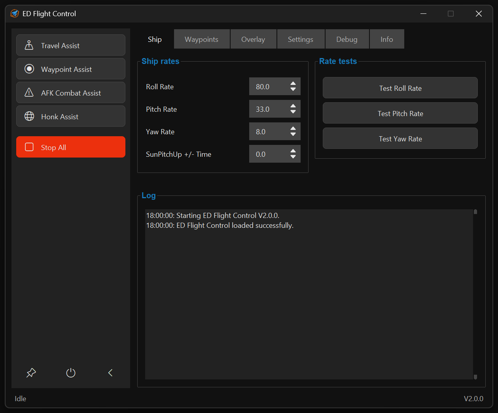
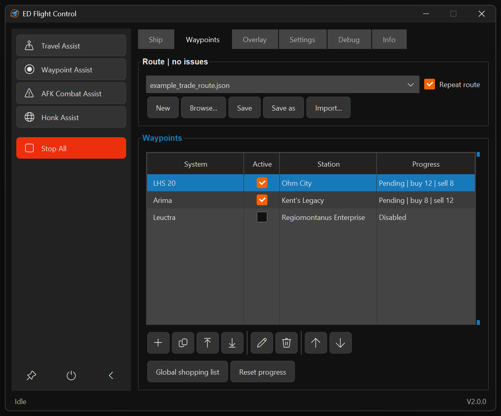
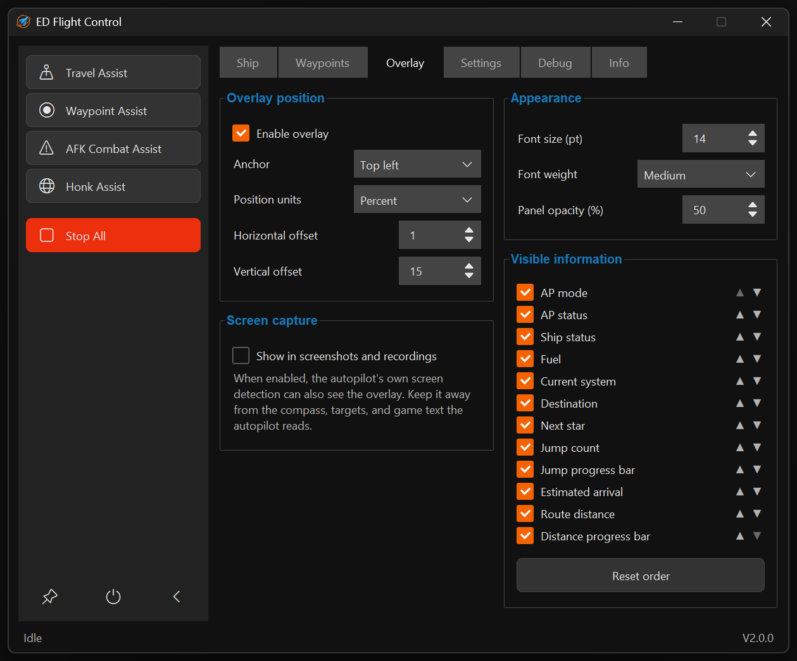
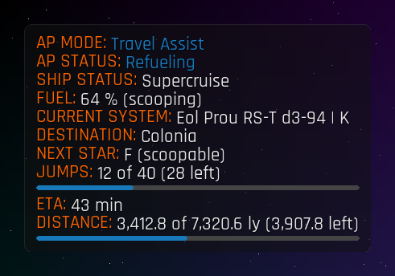
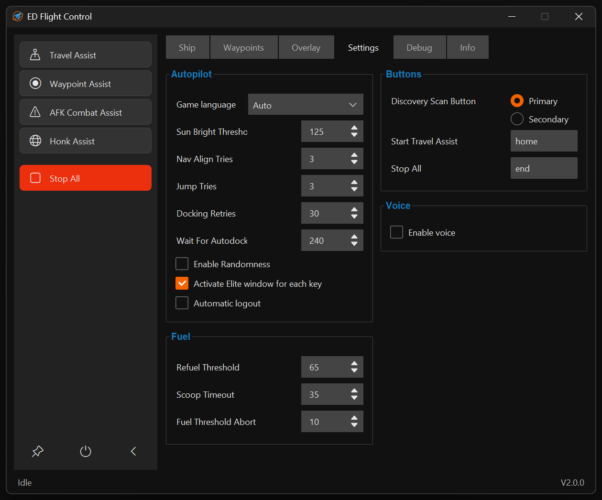
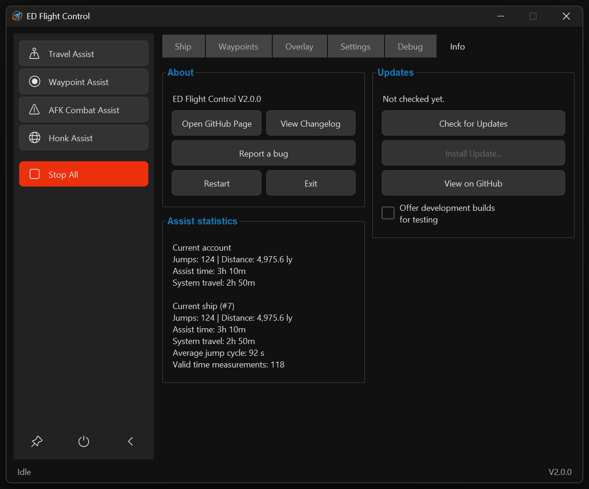
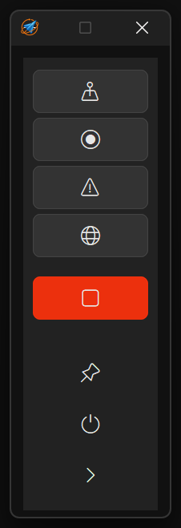

[](https://github.com/DopeEx/EDFlightControl/actions/workflows/ci.yml)
[](https://github.com/astral-sh/ruff)
[](.github/workflows/ci.yml)
[](LICENSE)

# ED Flight Control

ED Flight Control (EDFC) is a third-party Windows flight-control and autopilot tool for Elite Dangerous, offering optional assistance features.

## What it can do

- **Travel Assist** follows Galaxy Map routes with discovery scans and refueling, then continues to a selected
  local destination and requests docking where supported.

- **Waypoint Assist** visits saved systems and stations, with docking, trading, cargo transfers and resumable
  progress. The integrated editor supports route repetition, target-only plotting, and imports from copied trade
  routes, Spansh exports and legacy waypoint files.

- **Honk Assist** attempts a Discovery Scanner scan on entering each new system in supercruise; Analysis Mode
  is required.

- **AFK Combat Assist** monitors shields and fighters, attempts escape when shields fail, and attempts NPC fighter
  redeployment. Check its setup requirements and limitations before use.

- **Status overlay and statistics** show flight status, fuel and route progress, with an optional learned ETA for
  system travel. Local statistics track assisted jumps, distance and active time per account and ship.

- **Game languages** support English and German recognition, automatic language selection and additional
  data-only language packs. The application interface remains English.

- **Additional tools** include optional voice feedback and diagnostic CV views.

Detailed setup, behavior and limitations are covered in the guides under **Documentation** below.

## Requirements

- Windows
- Elite Dangerous
- Python 3.12 or 3.13 (recommended download:
  [Python 3.13.17 Windows installer (64-bit)](https://www.python.org/ftp/python/3.13.17/python-3.13.17-amd64.exe))
- A borderless game window, default HUD colours, and UI brightness of at least 50%
- A docking computer for automatic docking

By default, EDFC attempts to focus Elite Dangerous before each key or group of keys. Still keep the game focused
while an assist is active: Windows can reject focus changes, so inputs may reach another window.
A very wide field of view can also make target detection less reliable.

## Install and start

1. Download and extract the source ZIP from [Releases](https://github.com/DopeEx/EDFlightControl/releases)
   (listed by version, for example `v2.0.0`), or clone the repository.
2. Run `start_edfc.bat`. On first start it creates a private `venv` folder, installs the requirements, and launches
   ED Flight Control. Python 3.13 is selected when available; otherwise the installer uses Python 3.12.
3. Start Elite Dangerous and make sure the required keybindings are available. `fix_keybinds.bat` can fill missing
   bindings in a custom preset.
4. In ED Flight Control, set the roll, pitch, and yaw rates for the active ship.
5. Select an assist in the sidebar of the main window (only one assist runs at a time; **Stop All** safely stops it,
   including while the engine is waiting between actions). The
   default global hotkeys are **Home** (Travel Assist) and **End** (stop); change them in Settings if needed.

The sidebar can be collapsed, the window pinned on top, and settings are saved automatically.

The program stores its settings, ship profiles, waypoint files, route progress, statistics, logs, and debug output in `user_data/`.

**Updating:** Use **Info > Install Update...**, or run `update_edfc.bat` with the program closed.
The updater preserves `user_data/` and `venv`; changed dependencies still require running
`install_requirements.bat` manually. Testers can opt in to main development builds on the Info tab.
Manual downloads remain available on GitHub. The update guide under **Documentation** below covers channel
selection, backups, recovery and updating an older installation that does not yet include the updater.

**Moving to another folder:** Only when setting up a separate installation, copy your backed-up `user_data/` into it
before the first start. Do not copy the old `venv`; let the starter create a new environment.

The first OCR run requires internet access to download recognition models; they remain in `user_data/cache/paddlex/`
when the virtual environment is recreated. Example routes from `data/waypoints/` are copied to
`user_data/waypoints/` on first start.
If an existing installation reports an incompatible virtual environment, remove its `venv` folder
and run `install_requirements.bat`.

## Documentation

- [Keybindings and automatic fixer](docs/Keybindings.md)
- [Waypoint files, bookmarks, trading, and transfers](docs/Waypoint.md)
- [Game languages and contributing language packs](docs/Localization.md)
- [Updates and optional development builds](docs/Updates.md)
- [Assist workflows, overlay, statistics and troubleshooting](docs/Workflows.md)
- [Ship roll, pitch, and yaw tuning](docs/RollPitchYaw.md)
- [Project structure and development conventions](docs/Structure.md)
- [Changelog](CHANGELOG.md)

## Bug reports and feature requests

Use this repository's [GitHub issue tracker](https://github.com/DopeEx/EDFlightControl/issues) for bug reports and feature
requests, or select **Info > Report a bug** in the application. Search open and closed issues first, then choose
**Bug report** or **Feature request** and complete the form. Review logs and diagnostic images for player information
before sharing; attachments are optional.

## Development

Install the runtime requirements and development tools in the active environment:

```powershell
python -m pip install -r requirements.txt
python -m pip install -r requirements-dev.txt
```

Run the checks used by CI:

```powershell
ruff check .
ruff format --check .
python -m unittest discover -s tests -t .
```

The OCR test requires the full runtime dependencies; it is skipped in CI's slim environment.

To refresh the documentation images with isolated example data, see
[Documentation screenshots](docs/Structure.md#documentation-screenshots).

## Screenshots

Ship tab:



Waypoints tab:



Overlay tab:



Status overlay:



Settings tab:



Info tab:



Collapsed to the mode buttons:



## License and origins

ED Flight Control is developed from EDAPGui and builds on the original
[EDAutopilot project by SKai2](https://github.com/skai2/EDAutopilot).
It remains available under the [MIT license](LICENSE); the original copyright notice is preserved.

## Disclaimer

This repository is provided for educational purposes as a programming example covering file-based data, computer
vision and image matching with OpenCV, voice feedback, Windows integration, threading, and Python classes. Use the
software at your own risk.
