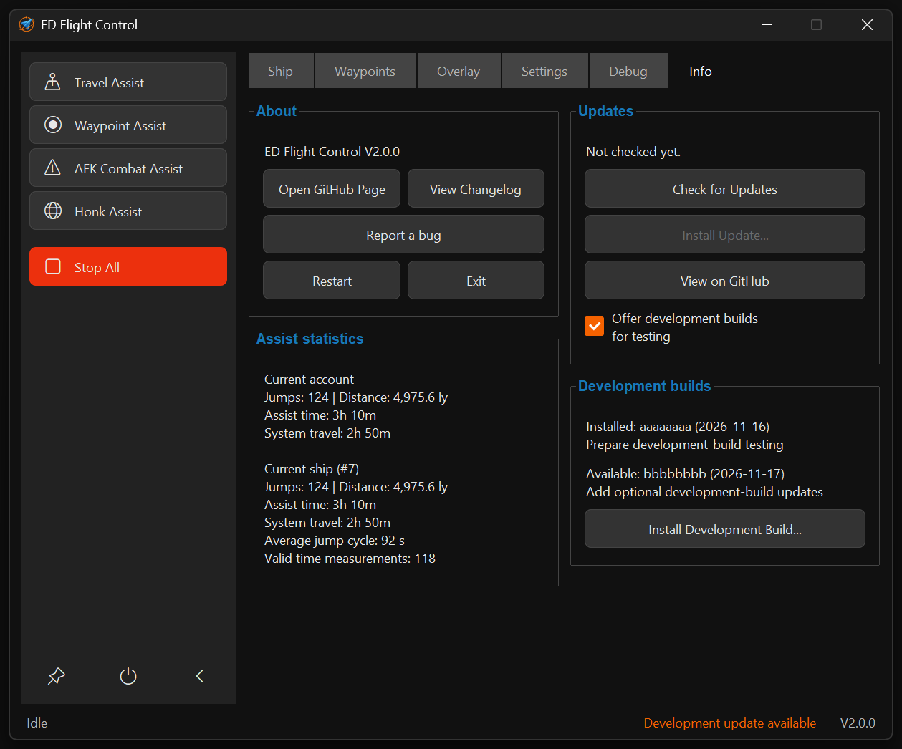

# Updating ED Flight Control

The Windows updater installs program files from `DopeEx/EDFlightControl` without Git or administrator rights.
Keep the extracted installation in a writable local folder. Windows PowerShell 5.1 is required.
Downloads use HTTPS with normal certificate verification. Windows or organizational policies may block scripts;
do not disable those protections to force an update.
The BAT uses a process-local PowerShell execution option; it does not change system execution policies.

## From the application

On **Info**, **Check for Updates** checks the latest stable GitHub release. The same check runs at startup.
**Install Update...** is enabled only when the release version is higher than the installed program version,
including when a main development build is installed. **View on GitHub** opens the release page for details
or a manual download.

The install button opens the standalone updater in a separate console window. It does not stop an assist
or close EDFC. Finish any running assist, save route edits, and close EDFC when ready. The updater cannot
replace program files while this installation is running. It asks for confirmation before replacing files;
it never terminates EDFC or unrelated Python processes.
It waits up to five minutes for EDFC to close; if you need longer, finish your work and start the updater again.

## Optional development builds

Enable **Offer development builds for testing** on **Info** to also check the current main commit.
The option is remembered between starts and is off by default. Installed revision details, available main
commit ID/date/message and **Install Development Build...** are shown in **Development builds** only while this option is enabled. Disabling
it hides those details and stops subsequent main checks; stable release checks remain enabled.
The footer calls these notifications **Development update available**; no Git knowledge is required.

Main builds are unpublished development snapshots and can contain bugs. The updater downloads the exact
commit shown when installation was requested, not whichever commit happens to be on main later.
The installed revision is recorded in `.update/installed.json` and replaced after each successful
installation, including reinstalls and switches between development builds and stable releases.
An installation extracted manually may
have no recorded commit; in that case EDFC offers the current main build without claiming to know its
previous revision.
**Exact build unknown** means no matching updater installation record is available. The program version
is still known, but its exact development snapshot cannot be identified; this is normal for a manual installation.

There is no separate GUI downgrade action. To return to the latest stable release, close EDFC and run
`update_edfc.bat` manually. Select the stable release even if it is the same version or older than the
development build. Back up `user_data/` before changing channels or installing an older version: preserving
files does not guarantee that an older program understands data saved by newer code.

## Standalone updater and recovery

Double-click `update_edfc.bat` in the installation folder. It works even when the GUI cannot start.
The default choice is the latest stable release; the other choice is the current main development build.
The GUI starts this same updater with the selected release tag or exact commit ID.

The updater stages and checks the download before exchanging program files. It keeps program-file backups
under `.update/backups/` and records interrupted exchanges in `.update/pending.json`. Run the BAT again
after an interrupted exchange so it can restore the previous program files before another attempt.
Current EDFC versions refuse to start while recovery is pending. Do not delete `.update/` during recovery.
The console stays open after completion or errors; diagnostic output is also written to `.update/updater.log`.
Program backups are not automatically deleted.

Only managed program folders and files are replaced; obsolete files inside those folders are removed.
`user_data/`, `venv/` and unrelated files at the installation root are left unchanged. Program backups do
**not** back up personal settings, routes, statistics or recognition models. Keep separate backups of
`user_data/` as appropriate. Do not put personal files inside program-owned folders such as `src/` or `assets/`.

The updater refuses Git working copies, including installations inside one, to protect local development
work. Use an independently extracted installation for tester updates. No Git installation is needed.
Only one updater can operate on an installation at a time.

## Python dependencies and limitations

The updater does **not** install Python, change packages, or recreate the virtual environment. When
`requirements.txt` changes, it tells you to run `install_requirements.bat` before starting EDFC again.
Follow any additional release instructions. If the requirements installer reports an incompatible existing
environment, follow its instructions to recreate `venv/`; downloaded OCR models remain in `user_data/`.

An application restart can be offered after a successful update without changed requirements.
Neither startup nor the update check installs updates automatically.

Release updates use the published `EDFlightControl-<version>.zip` asset. Main updates use a source archive
at an exact commit. Archive checks and a GitHub asset digest when available help detect damaged or
unexpected packages; they are not an independent publisher signature. Network errors, API rate limits
and invalid packages stop the operation rather than silently switching update channels.

Older releases and main snapshots may not contain the updater or these GUI controls. They can still be
installed: the installed standalone launcher and updater are retained, so a later manual update remains possible.
Such a snapshot has only its original GUI controls; installing it does not add the new update controls to old code.
For the first upgrade from an installation without the updater, close EDFC, back up `user_data/`, and
extract the new release into the existing folder, keeping `user_data/` and `venv/`. Follow its dependency
instructions. Subsequent updates can use the BAT or GUI.
